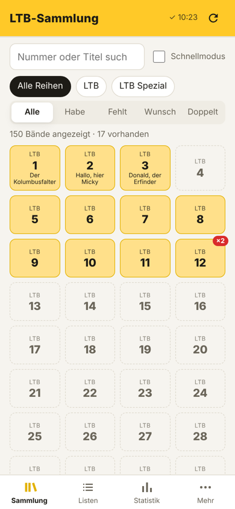
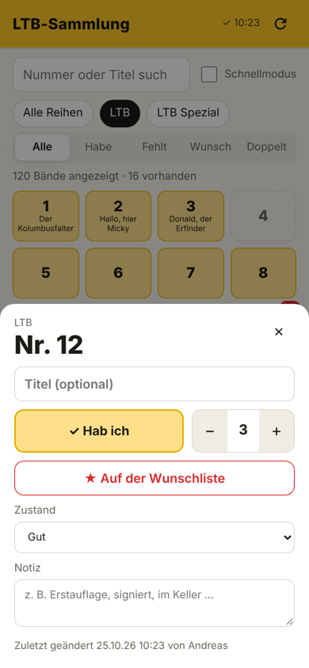
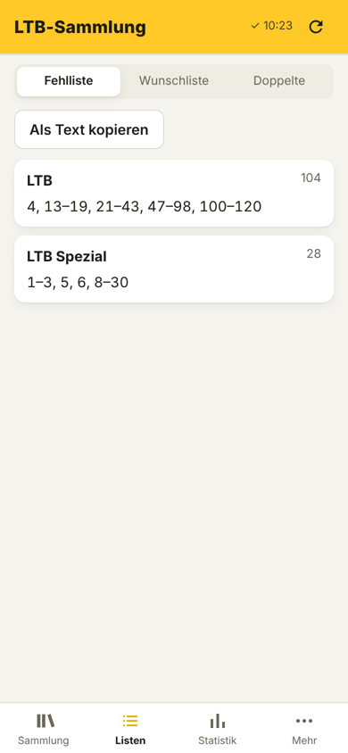
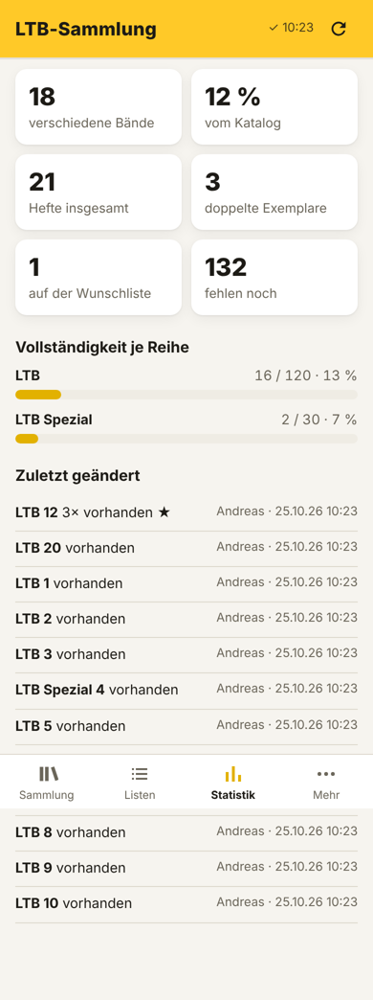

# LTB-Sammlung

Eine installierbare Web-App (PWA) zum Verwalten einer gemeinsamen Sammlung **Lustiger Taschenbücher**.
Ein Google Sheet dient als Datenbank, dadurch sind alle Handys synchron. Kostenlos, ohne Play Store.

<p>
 
 
</p>

**Funktionen:** Katalog zum Abhaken (Reihen mit „von–bis“ anlegen) · Schnellmodus · Fehlliste, Wunschliste, Doppelte (als Text kopierbar) · Zustand & Notizen · Statistik je Reihe · Import aus kommagetrennten Listen (z. B. von einer KI aus Fotos) · Titel-Import · CSV-Export · Einrichtungslink für weitere Handys · Demo-Modus · Hell/Dunkel.

## Aufbau

```
├── docs/               die App (wird per GitHub Pages ausgeliefert)
├── apps-script/Code.gs Backend – kommt ins Google Sheet
├── tests/              Mock-Backend + Tests (nur für Entwicklung)
└── screenshots/
```

Datenfluss: App ⇄ Apps-Script-Web-App (JSON, mit API-Schlüssel) ⇄ Google Sheet, Blatt „Bände“
(`Reihe | Nr | Titel | Anzahl | Wunsch | Zustand | Notiz | Geändert | Von`).

---

## 1. Google Sheet + Backend (am PC)

1. Neues Google Sheet anlegen, z. B. „LTB-Sammlung“.
2. **Erweiterungen → Apps Script**. Den Inhalt von `apps-script/Code.gs` komplett einfügen (vorhandenen Code ersetzen) und speichern.
3. Oben in der Funktionsauswahl **`setup`** wählen → **Ausführen**.
   Google fragt nach Berechtigungen: *Berechtigungen prüfen → Konto wählen → „Erweitert“ → „Zu … wechseln (unsicher)“ → Zulassen*.
   (Die Warnung kommt, weil das Script von dir selbst und nicht von Google geprüft ist.)
4. Im Sheet gibt es jetzt die Blätter **„Bände“** und **„Einstellungen“**. Im Blatt „Einstellungen“ steht dein **API-Schlüssel**.
5. Im Apps-Script-Editor: **Bereitstellen → Neue Bereitstellung** → Zahnrad → **Web-App**
   - Ausführen als: **Ich**
   - Zugriff: **Jeder**
   → **Bereitstellen** und die **Web-App-URL** (endet auf `/exec`) kopieren.

> „Jeder“ heißt: Wer URL **und** Schlüssel kennt, kann zugreifen. Ohne Schlüssel kommt niemand an die Daten.
> Neuer Schlüssel nötig? Funktion `neuerSchluessel` ausführen.

## 2. Repo auf GitHub anlegen und App veröffentlichen

1. Auf github.com: **New repository** → Name z. B. `ltb` → **Public** → *Create repository*.
2. Entweder per Git:
   ```bash
   git remote add origin https://github.com/DEINNAME/ltb.git
   git push -u origin main
   ```
   oder ohne Git: auf der leeren Repo-Seite „uploading an existing file“ → **alle Dateien und Ordner** dieses Repos hineinziehen → *Commit changes*.
3. **Settings → Pages** → Source: *Deploy from a branch* → Branch **`main`**, Ordner **`/docs`** → Save.
4. Nach 1–2 Minuten läuft die App unter `https://DEINNAME.github.io/ltb/`.

Das Repo enthält keine geheimen Daten – URL und Schlüssel werden erst in der App eingetragen.

## 3. Erstes Handy einrichten

1. Die App-Adresse in **Chrome** öffnen.
2. **Mehr → Einstellungen**: Web-App-URL, API-Schlüssel und deinen Namen eintragen → **Speichern & testen**.
3. Chrome-Menü **⋮ → „App installieren“** bzw. **„Zum Startbildschirm hinzufügen“**.

## 4. Weitere Handys

Auf dem eingerichteten Handy: **Mehr → Einstellungen → „Einrichtungslink teilen“** → per WhatsApp o. ä. schicken.
Auf dem anderen Handy den Link in Chrome öffnen → ist sofort verbunden → Namen eintragen → „App installieren“.

## 5. Katalog & Bestand befüllen

1. **Mehr → Katalog: Reihe anlegen**, z. B. `LTB` von 1 bis zur aktuellen Nummer, `LTB Spezial` von 1 bis …
   Kommt ein neuer Band heraus: einfach nochmal mit der neuen „bis“-Nummer anlegen – vorhandene bleiben unverändert.
2. **Mehr → Bestand importieren**: Fotos von deinen Bänden mit der KI deiner Wahl abfotografieren, den Prompt aus der App verwenden (Button „Prompt kopieren“), die Liste einfügen → **Prüfen** → **Importieren**.
   Erlaubte Formate: `1, 2, 5-9`, `LTB 12`, `Spezial 45`, `Spezial 7 x2`. Doppelt genannte Bände zählen als Doppelte.
3. Titel (optional): **Mehr → Katalog: Titel importieren**, Zeilen im Format `Nr; Titel` – z. B. von einer KI aus einer Bandliste erstellen lassen oder direkt aus einer Tabelle kopieren.

## Bedienung

- **Antippen** eines Bandes öffnet die Details (Anzahl, Wunschliste, Zustand, Notiz).
- **Schnellmodus** (Häkchen oben): Antippen hakt direkt ab bzw. wieder aus – ideal zum Durchgehen des Regals.
- **Listen**: Fehlliste, Wunschliste, Doppelte – mit „Als Text kopieren“ zum Weiterschicken (z. B. für den Flohmarkt).
- Gelb = vorhanden, gestrichelt = fehlt, ★ = Wunschliste, rotes ×2 = doppelt.
- Die App aktualisiert sich, wenn man sie wieder öffnet; sonst ⟳ oben rechts.
- Das Sheet kannst du jederzeit auch direkt bearbeiten (z. B. Reihe umbenennen oder Zeilen löschen).
- **Demo-Modus** (unter Einstellungen) zeigt Beispieldaten nur auf dem Gerät – zum Ausprobieren ohne Sheet.

## Updates

- **App**: geänderte Dateien im Ordner `docs/` committen bzw. bei GitHub erneut hochladen – die Handys holen die neue Version beim nächsten Öffnen automatisch.
- **Backend**: Code in Apps Script ersetzen → **Bereitstellen → Bereitstellungen verwalten → Bearbeiten (Stift) → Version: Neue Version → Bereitstellen**. So bleibt die URL gleich.

## Wenn etwas nicht klappt

| Meldung | Lösung |
|---|---|
| „Falscher API-Schlüssel“ | Schlüssel aus dem Blatt „Einstellungen“ exakt übernehmen. |
| „Unerwartete Antwort …“ | URL muss auf `/exec` enden; Zugriff der Web-App auf **Jeder** stellen. |
| „Backend nicht eingerichtet“ | Funktion `setup` einmal ausführen. |
| Änderungen am Code wirken nicht | Neue **Version** bereitstellen (siehe Updates). |

## Entwicklung

```bash
npm install          # nur für die Browser-Tests (Playwright)
npm test             # Backend-Logik gegen ein simuliertes Google Sheet
npm run serve        # App + Mock-Backend auf http://localhost:8765
npm run e2e          # Klick-Test im Browser (Server muss laufen), Screenshots in tests/shots/
```

Bei App-Änderungen in `docs/sw.js` den Cache-Namen (`ltb-v1`) hochzählen, wenn Offline-Dateien hinzukommen.
